<div align="center">

# PULSE: Patient Unified Longitudinal Signal Engine
### Clinical Decision Support System & Generative Multimodal Biomarker Synthesis

[](https://doi.org/10.1038/s43588-026-01026-5)
[](https://pytorch.org/)
[](https://fastapi.tiangolo.com/)
[](https://nextjs.org/)
[](https://tauri.app/)
[](https://opensource.org/licenses/MIT)

<p align="center">
  <b>A unified deep generative framework for longitudinal clinical mosaic alignment, dense omics imputation, and dynamic disease trajectory forecasting.</b>
</p>

<p align="center">
  <a href="#theoretical-foundations--mathematical-formulation"><b>Architecture & Math</b></a> •
  <a href="#clinical-benchmark-results"><b>Clinical Benchmarks</b></a> •
  <a href="#clinical-decision-support-system-cdss"><b>CDSS Workspace</b></a> •
  <a href="#installation--quick-start"><b>Quick Start</b></a> •
  <a href="#original-author--paper-attribution"><b>Paper Attribution</b></a> •
  <a href="#domain--medico-technical-advisory-acknowledgments"><b>Advisory Acknowledgments</b></a>
</p>

---

<p align="center">
  
</p>

</div>

---

## Executive Summary

Routine clinical records are characterized by **longitudinal mosaic missingness**: inexpensive blood tests and vital signs are obtained frequently at repeated patient visits, whereas deep molecular profiles (NMR metabolomics, Olink/SomaScan proteomics) are gathered only intermittently or at baseline.

Existing single-cell multi-omics frameworks (e.g., MIDAS, scVAEIT, StabMap) treat biological observations as isolated, static cross-sections. However, human disease progression is a continuous physiological trajectory governed by personalized homeostatic baselines.

**PULSE** (**P**atient **U**nified **L**ongitudinal **S**ignal **E**ngine) reformulates longitudinal patient care as a **coupled dynamical system**:
- **Cross-Modal Grounding**: Models routine blood markers and high-dimensional omics as different views of a shared continuous latent physiological process.
- **Personalized Baselines**: Anchors inference to an individual's temporal trajectory, recognizing that rates of change ($\Delta$) relative to baseline set-points carry far more diagnostic significance than population-average absolute thresholds.
- **Generative Synthesis**: Imputes thousands of unmeasured plasma metabolites and proteins from simple routine lab panels, enabling calibrated 10-year and 30-day disease risk forecasting at a fraction of standard assay costs.

---

## Key System Highlights

| Pillar | Mechanism | Clinical Impact |
| :--- | :--- | :--- |
| **Longitudinal Memory** | Propagated Past-State Prior ($Z_P$) via GRU or Causal Transformer | Constrains high-dimensional imputation to biologically plausible trajectories, avoiding population mean regression. |
| **Soft Semantic Alignment** | Information-Theoretic Symmetrical Jeffrey Divergence ($J(q_a, q_b)$) | Preserves posterior variance and biological heterogeneity across modalities without mode collapse. |
| **Active Masking Protocol** | Single-Modality Uniform Withholding ($p_{\text{mask}} = 0.6$) | Prevents trivial intra-visit identity shortcuts, compelling decoders to rely on cross-modal and historical dynamics. |
| **Adversarial Regularization** | Gradient Reversal Layer (GRL) Missingness Discriminator ($D_m$) | Eliminates missingness artifacts, ensuring synthesized biomarker trajectories mimic genuine human physiology. |
| **Interactive CDSS** | Tauri v2 Standalone Desktop App + Next.js Workspace | Categorizes biomarkers into physiological panels (Lipid, Metabolic, Neuro, Renal) with calibrated prognostic risk radar. |

---

## Theoretical Foundations & Mathematical Formulation

```
Longitudinal Clinical Encounter Architecture:
Encounter t-1                   Encounter t (Current)                           Encounter t+1
┌─────────────┐                 ┌───────────────────────────┐                   ┌─────────────┐
│ Past State  │ ──GRU/Trans──>  │  Past-State Encoder (Z_P) │ ──┐               │ Future State│
│   h_{t-1}   │                 └───────────────────────────┘   │               │   h_{t+1}   │
└─────────────┘                 ┌───────────────────────────┐   ├──> Jeffrey ──>└─────────────┘
                                │  Modality A Encoders (Z_A)│ ──┤    Alignment         ▲
[Routine Labs] ────────────────>└───────────────────────────┘   │    + Equal-Weight    │
                                ┌───────────────────────────┐   │    Visit Fusion ─────┘
[Missing Omics] (Synthesized)<──│  Generative Decoders      │<──┴──> [ z_{visit} ]
                                └───────────────────────────┘
```

### 1. The Longitudinal Clinical Mosaic Problem

Let patient $i$ possess a sequence of encounters indexed by $t \in \{1, \dots, T_i\}$.  
At encounter $t$, let $x_{i,t}^{(m)} \in \mathbb{R}^{D_m}$ denote the measured feature vector for modality $m \in \mathcal{M}$. Due to mosaic collection, only an active subset $\mathcal{O}_{i,t} \subseteq \mathcal{M}$ is observed.

Modality availability is formalized by a ternary indicator $s_{i,t}^{(m)} \in \{0, 1, 2\}$:
- $s_{i,t}^{(m)} = 0$ (**Observed**): Available in clinic; routed to the corresponding modality encoder.
- $s_{i,t}^{(m)} = 1$ (**Actively Masked**): Measured in reality, but intentionally withheld from encoders during training to force cross-modal and historical synthesis; supervised via ground-truth targets.
- $s_{i,t}^{(m)} = 2$ (**Naturally Missing**): Absent in clinical practice; decoded by the network, but generates zero reconstruction loss gradient.

---

### 2. Variational Modality Encoders & Past-State Integration ($Z_P$)

For each observed modality $m \in \mathcal{O}_{i,t}$, a modality-specific variational encoder $q_{\phi_m}$ maps high-dimensional clinical inputs into a shared $D$-dimensional latent Gaussian manifold (default $D = 16$):

$$q_{\phi_m}\left(z_{i,t}^{(m)} \mid x_{i,t}^{(m)}\right) = \mathcal{N}\left(\mu_{i,t}^{(m)}, \text{diag}\left((\sigma_{i,t}^{(m)})^2\right)\right)$$

Simultaneously, the patient's summarized history up to encounter $t - 1$, denoted by hidden representation $h_{i,t}$, is processed by the **Past-State Variational Encoder** $q_{\phi_P}$:

$$q_{\phi_P}\left(z_{P, i,t} \mid h_{i,t}\right) = \mathcal{N}\left(\mu_{P, i,t}, \text{diag}\left((\sigma_{P, i,t})^2\right)\right)$$

> **Clinical Rationale**: Human biomarkers fluctuate within tight personal homeostatic ranges. Incorporating $Z_P$ provides an individualized reference point, turning ill-posed cross-sectional imputation into continuous trajectory completion.

---

### 3. Distributional Soft Alignment via Jeffrey Divergence

Standard multi-view VAEs frequently suffer from geometric collapse when enforcing deterministic Euclidean point-matching (e.g., MSE on $\mu$). PULSE enforces **distributional soft alignment** via the symmetrical **Jeffrey Divergence**.

For two diagonal multivariate Gaussian posteriors $q_a = \mathcal{N}(\mu_a, \text{diag}(\sigma_a^2))$ and $q_b = \mathcal{N}(\mu_b, \text{diag}(\sigma_b^2))$, the Kullback-Leibler (KL) divergence is:

$$D_{\text{KL}}(q_a \parallel q_b) = \frac{1}{2} \sum_{d=1}^D \left[ \log\left(\frac{\sigma_{b,d}^2}{\sigma_{a,d}^2}\right) + \frac{\sigma_{a,d}^2 + (\mu_{a,d} - \mu_{b,d})^2}{\sigma_{b,d}^2} - 1 \right]$$

The **Jeffrey divergence** $J(q_a, q_b) = D_{\text{KL}}(q_a \parallel q_b) + D_{\text{KL}}(q_b \parallel q_a)$ yields the exact closed-form formulation:

$$J(q_a, q_b) = \frac{1}{2} \sum_{d=1}^D \left[ \frac{\sigma_{a,d}^2}{\sigma_{b,d}^2} + \frac{\sigma_{b,d}^2}{\sigma_{a,d}^2} + (\mu_{a,d} - \mu_{b,d})^2 \left(\frac{1}{\sigma_{a,d}^2} + \frac{1}{\sigma_{b,d}^2}\right) - 2 \right]$$

Let $\mathcal{B}_{i,t} = \{q_{\phi_m} : m \in \mathcal{O}_{i,t}\} \cup \{q_{\phi_P}\}$ denote all active latent branches at encounter $t$. The alignment loss is computed over all unordered pairs $\mathcal{P}_{i,t}$:

$$\mathcal{L}_{\text{align}}^{(i,t)} = \frac{1}{|\mathcal{P}_{i,t}|} \sum_{(a,b) \in \mathcal{P}_{i,t}} J(q_a, q_b)$$

---

### 4. Equal-Weight Visit-State Fusion ($Z_{\text{visit}}$)

Available modality states and historical context are aggregated into a single unified visit coordinate $z_{i,t}$ via explicit equal-weight averaging:

$$z_{i,t} = \frac{\mu_{P, i,t} + \sum_{m \in \mathcal{O}_{i,t}} \mu_{i,t}^{(m)}}{|\mathcal{O}_{i,t}| + 1}$$

- The denominator $+1$ accounts specifically for $\mu_{P, i,t}$. Current measurements and prior history are balanced symmetrically.
- If no modalities are observed at encounter $t$ ($|\mathcal{O}_{i,t}| = 0$), the visit coordinate transitions seamlessly to pure historical carry-forward: $z_{i,t} = \mu_{P, i,t}$.

---

### 5. Temporal State Propagation: Recurrent (GRU) vs. Causal Transformer

From visit coordinate $z_{i,t}$, the historical context vector $h_{i,t+1}$ for the subsequent encounter is updated autoregressively:

- **Recurrent Engine (`temporal_model="recurrent"`)**:  
  Uses a Gated Recurrent Unit (GRU) cell for parameter-efficient sequence modeling:
  $$h_{i,t+1} = \text{GRUCell}(z_{i,t}, h_{i,t})$$
  *Optimized for outpatient encounters with 2–5 visits.*

- **Causal Transformer Engine (`temporal_model="transformer"`)**:  
  Employs multi-head causal self-attention with temporal sinusoidal position encodings:
  $$h_{i,t+1} = \text{TransformerEncoder}\left(\text{CausalMask}\left([z_{i,1}, \dots, z_{i,t}]\right)\right)_{t}$$
  *Optimized for dense, high-frequency encounters (e.g., 48-hour continuous ICU step series).*

---

### 6. Single-Modality Active Masking Protocol

To ensure encoders learn cross-modal temporal dependencies rather than memorizing intra-visit shortcuts:
- At encounters with $|\mathcal{O}_{i,t}| \ge 2$ observed modalities, active masking triggers with probability $p_{\text{mask}} = 0.6$.
- Exactly one observed modality $m^*$ is uniformly chosen at random and relabeled to $s = 1$.
- Modality $m^*$ is masked from the encoder inputs, requiring the remaining modalities and past-state prior $Z_P$ to synthesize $\hat{x}_{i,t}^{(m^*)}$.
- Supervised reconstruction loss is applied against the ground-truth values of $x_{i,t}^{(m^*)}$.

---

### 7. Modality-Wise Adversarial Regularization (GRL)

To eliminate subtle reconstruction artifacts introduced by missingness patterns, each modality is equipped with a binary discriminator $D_m$ trained with a **Gradient Reversal Layer (GRL)**:

$$\mathcal{L}_{\text{adv}} = \sum_{i,t} \sum_{m} \text{BCE}\left(D_m\left(\hat{x}_{i,t}^{(m)}\right), y_{i,t}^{(m)}\right)$$

During backpropagation, gradients are inverted by $-\lambda_{\text{grl}} \nabla$, forcing generative decoders to produce natural biological profiles rather than synthetic surrogates.

---

### 8. Complete Training Objective & Annealed ELBO

The final scalar loss minimized during end-to-end training is:

$$\mathcal{L} = \mathcal{L}_{\text{rec}} + \lambda_{\text{KL}} \cdot \alpha(e) \cdot \mathcal{L}_{\text{KL}} + \lambda_{\text{align}} \cdot \mathcal{L}_{\text{align}} + \lambda_{\text{adv}} \cdot \mathcal{L}_{\text{adv}}$$

where:
- **Reconstruction Loss**:
  $$\mathcal{L}_{\text{rec}} = \sum_{i,t} \sum_{m} \mathbb{I}[s_{i,t}^{(m)} \in \{0, 1\}] \cdot \text{MSE}\left(\hat{x}_{i,t}^{(m)}, x_{i,t}^{(m)}\right)$$
- **Gaussian Prior Regularization**:
  $$\mathcal{L}_{\text{KL}} = \sum_{b \in \mathcal{B}_{i,t}} D_{\text{KL}}(q_b \parallel \mathcal{N}(0, I))$$
- **KL Warmup Schedule $\alpha(e)$**: Linearly scaled from $0 \to 1$ across the first 50 epochs ($e \in [1, 50]$) to prevent posterior collapse.

---

## Clinical Benchmark Results

### 1. UK Biobank Two-Visit Metabolomics Imputation (251 Biomarkers)

Reconstructing follow-up NMR metabolomic profiles (**251 biomarkers**) using only routine blood markers (**61 routine lab tests**) at follow-up, conditioned on baseline medical history ($n = 10,000$ participants; 7,000 train / 3,000 test):

```
Metabolomics Imputation Correlation (Pearson r across 251 metabolites):
PULSE (Ours)   [██████████████████████████████████████] 0.781 ± 0.012
scVAEIT        [████████████████████████████           ] 0.654 ± 0.015
MIDAS          [████████████████████████               ] 0.638 ± 0.016
StabMap        [████████████████████                   ] 0.589 ± 0.018
```

| Model / Framework | Architecture Type | Context Employed | Pearson's $r$ ($\uparrow$) | MAE ($\downarrow$) | MSE ($\downarrow$) |
| :--- | :--- | :--- | :---: | :---: | :---: |
| **PULSE (Ours)** | **Longitudinal Variational** | **Baseline History ($t=0$) + Current Labs ($t=1$)** | **0.781 ± 0.012** | **0.312 ± 0.008** | **0.201 ± 0.009** |
| **scVAEIT** | Static Masked VAE | Current Labs ($t=1$) only | 0.654 ± 0.015 | 0.405 ± 0.010 | 0.324 ± 0.012 |
| **MIDAS** | Static Product-of-Experts | Current Labs ($t=1$) only | 0.638 ± 0.016 | 0.418 ± 0.011 | 0.341 ± 0.013 |
| **StabMap** | Static MNN Manifold | Current Labs ($t=1$) only | 0.589 ± 0.018 | 0.462 ± 0.013 | 0.410 ± 0.015 |

> **Dynamic Change Concordance**: On predicting longitudinal within-person change ($\Delta = \text{Follow-up} - \text{Baseline}$), PULSE achieves **$r = 0.850$**, confirming that it captures individual temporal drift rather than mean reversion.

---

### 2. UKB-PPP Plasma Proteomics Synthesis (2,923 Proteins) & Disease Prediction

Synthesizing **2,923 plasma protein abundances** from 61 blood markers and prior ICD trajectories ($n = 50,000$ UK Biobank participants):

| Disease Outcome (10-Year Incident Risk) | Measured Proteomics AUROC | **PULSE Synthesized Proteomics AUROC** | Delta ($\Delta$) |
| :--- | :---: | :---: | :---: |
| **Dementia / Alzheimer's** | 0.835 | **0.831** | -0.004 |
| **Heart Failure** | 0.801 | **0.798** | -0.003 |
| **Myocardial Infarction** | 0.789 | **0.784** | -0.005 |
| **Chronic Obstructive Pulmonary Disease (COPD)** | 0.775 | **0.772** | -0.003 |
| **Ischemic Stroke** | 0.749 | **0.745** | -0.004 |
| **Type 2 Diabetes Mellitus** | 0.731 | **0.728** | -0.003 |

> **Clinical Significance**: PULSE-synthesized proteomics models achieve disease forecasting accuracy statistically indistinguishable from models trained on genuine, high-cost laboratory proteomics.

---

### 3. Multicenter Acute Care Trajectories (MIMIC-III & Wenzhou ICU)

30-day post-discharge readmission prediction from the first 48 hours of ICU admission, aggregated into twelve 4-hour temporal steps combining structured labs and unstructured nursing notes:

| Cohort | Metric | Lab Transformer Only | Clinical Notes (Llama 3) | Late Fusion Baseline | **PULSE (Ours)** |
| :--- | :--- | :---: | :---: | :---: | :---: |
| **MIMIC-III (US)** | **AUROC** | 0.639 | 0.647 | 0.663 | **0.713** (0.691–0.732) |
| ($n = 44,265$) | **AUPRC** | 0.110 | 0.127 | 0.130 | **0.193** (0.167–0.224) |
| **Wenzhou ICU (China)** | **AUROC** | 0.647 | 0.691 | 0.706 | **0.735** (0.683–0.789) |
| ($n = 13,816$) | **AUPRC** | 0.116 | 0.273 | 0.317 | **0.388** (0.298–0.480) |

---

## Clinical Decision Support System (CDSS)

This repository includes a production-grade **Clinical Decision Support System (CDSS)** application implementing the PULSE inference engine.

```
┌────────────────────────────────────────────────────────────────────────────────────────┐
│  PULSE Clinical Decision Support System (CDSS)                                         │
├─────────────────┬──────────────────────────────────────────────────────────────────────┤
│  Panels         │  Longitudinal Trajectory Workspace                                   │
│  ├─ Lipid       │   LDL-C: [142 mg/dL ──> 128 mg/dL ──> 112 mg/dL (Controlled)]        │
│  ├─ Metabolic   │   HbA1c: [ 6.8%     ──>  6.5%    ──>  6.1%     (Improving)]         │
│  ├─ Neuro       │   NfL:   [14.2 pg/mL──> 16.8 pg/mL──> 18.2 pg/mL (Monitoring)]       │
│  └─ Renal       │   eGFR:  [88 mL/min ──>  84 mL/min──>  81 mL/min (Mild Risk)]        │
├─────────────────┼──────────────────────────────────────────────────────────────────────┤
│  Risk Forecast  │  10-Year ASCVD: 14.2%  •  30-Day ICU Readmission: 4.8%  •  CKD: 8.1% │
│  Inference Mode │  [Run PULSE Synthesis] ──> Synthesizes 25+ Omics Biomarkers         │
└─────────────────┴──────────────────────────────────────────────────────────────────────┘
```

### Core Features

1. **Logical Biomarker Panels**:
   - **Lipid Panel**: Total Cholesterol, LDL-C, HDL-C, Triglycerides.
   - **Metabolic Panel**: Fasting Plasma Glucose, Glycated Hemoglobin (HbA1c), Fasting Insulin.
   - **Neurological & Inflammatory Panel**: Neurofilament Light Chain (NfL), High-Sensitivity C-Reactive Protein (hs-CRP).
   - **Renal & Hepatic Panel**: Serum Creatinine, Estimated Glomerular Filtration Rate (eGFR), Blood Urea Nitrogen (BUN), ALT.
2. **Clinical Encounter Recording**:
   - Structured modal for logging physical vitals, routine laboratory panels, and clinician progress notes.
   - Quick presets for **Outpatient Cardiovascular Assessment** and **ICU Sepsis / Acute Kidney Injury**.
3. **FHIR & CSV Interoperability**:
   - One-click longitudinal observation export compliant with HL7 FHIR standard bundles.
4. **Standalone Multi-Platform Desktop Deployment**:
   - Built on **Tauri v2** and **Next.js** with asynchronous background backend management:
     - **Linux**: Universal `.AppImage`, `.deb`, `.rpm` bundles.
     - **Windows**: `.exe` and `.msi` standalone installers with headless WSL bridge.
     - **macOS**: Universal Apple Silicon / Intel `.dmg` installer.
   - **Dual-Mode Launcher**: Switch between native desktop workstation and browser mode (`http://localhost:8000`).

---

## Installation & Quick Start

### 1. Python Environment Setup

```bash
# Clone the repository
git clone https://github.com/p19racha/LongitudinalGeneration.git
cd LongitudinalGeneration

# Create virtual environment
python3 -m venv .venv
source .venv/bin/activate  # On Windows: .venv\Scripts\activate

# Install dependencies
pip install -r requirements.txt
pip install -e .
```

### 2. Python API Quick Start

```python
import torch
from pulse.model import PulseModel
from pulse.data.dataset import LongitudinalDataset, collate_visits, create_synthetic_data

device = "cuda" if torch.cuda.is_available() else "cpu"

# 1. Define input modality dimensions
modality_dims = {
    "routine_labs": 61,
    "metabolomics": 251,
}

# 2. Instantiate PULSE model
model = PulseModel(
    modality_dims=modality_dims,
    latent_dim=16,
    hidden_dim=64,
    temporal_model="recurrent",  # or "transformer"
    kl_weight=1e-3,
    align_weight=1.0,
    active_mask_prob=0.6,
).to(device)

# 3. Generate sample longitudinal data
synthetic_data, masks = create_synthetic_data(num_patients=16, max_visits=3, modality_dims=modality_dims)
dataset = LongitudinalDataset(synthetic_data, masks)
batch = collate_visits([dataset[i] for i in range(16)])

# 4. Perform forward pass and evaluate loss
output = model(batch["visits_data"], batch["missing_masks"], return_loss=True)
print(f"Total Loss: {output['loss']:.4f}")
print(f"Reconstruction Loss: {output['losses']['loss_recon']:.4f}")
print(f"Jeffrey Alignment Loss: {output['losses']['loss_align']:.4f}")
```

### 3. Launching the Interactive CDSS Application

#### Desktop App (Recommended)
Download the standalone installer for your operating system from the [Latest Releases](https://github.com/p19racha/LongitudinalGeneration/releases/latest):
- **Linux**: Run `./PULSE-CDSS_1.0.1_amd64.AppImage`
- **Windows**: Execute `PULSE-CDSS_1.0.1_x64-setup.exe`
- **macOS**: Install `PULSE-CDSS_1.0.1_universal.dmg`

#### Web Development Mode
```bash
# Terminal 1: Launch FastAPI backend
source .venv/bin/activate
uvicorn server.main:app --host 0.0.0.0 --port 8000

# Terminal 2: Launch Next.js frontend
cd frontend
npm install
npm run dev
# Navigate to http://localhost:3000
```

---

## Original Author & Paper Attribution

This research, algorithm design, and foundational mathematical implementation were created and published by:

* **Lead Author & Originator**: **Wei Wu** ([@ww20hust](https://github.com/ww20hust))  
  *Department of Big Data and Biomedical AI, College of Future Technology, Peking University & Peking-Tsinghua Center for Life Sciences, Beijing, China*  
  *Artificial Intelligence Cross Disciplinary Research Institute, Faculty of Medicine, Macau University of Science and Technology, Macau, China*  
  *Guangzhou National Laboratory, Guangzhou, China*  
  - Email: `ww20ya@163.com`  
  - GitHub: [https://github.com/ww20hust](https://github.com/ww20hust)
* **Co-First Authors** *(equal contribution)*:  
  Wei Wu, Gen Li, Kai Wang, Hui Xu, Haodi Xiao, Changxi Hu, Sian Liu, Cheng Tang
* **Corresponding Author**:  
  **Prof. Kang Zhang** (`kang.zhang@gmail.com`), *Macau University of Science and Technology, Wenzhou Medical University, and Guangzhou National Laboratory*
* **Consortium**:  
  On behalf of the **International Consortium of Digital Twins in Healthcare and Medicine**
* **Primary Publication**:  
  *"Longitudinal alignments and syntheses of multimodal clinical data for personalized medicine with the PULSE framework"*, **Nature Computational Science** (2026). DOI: [10.1038/s43588-026-01026-5](https://doi.org/10.1038/s43588-026-01026-5)  
  *The full peer-reviewed paper is included in this repository: [`Longitudinal alignments and syntheses of multimodal clinical data for personalized medicine with the PULSE framework.pdf`](file:///home/racha/LongitudinalGeneration/Longitudinal%20alignments%20and%20syntheses%20of%20multimodal%20clinical%20data%20for%20personalized%20medicine%20with%20the%20PULSE%20framework.pdf)*

---

## Domain & Medico-Technical Advisory Acknowledgments

Special recognition and formal gratitude are expressed to:

<div align="center">

### **Perugupalli Lakshmi Harika**
📧 `91197503046@dnu.edu.vn`

</div>

> **Advisory Citation**: For her dedicated domain advisory and medico-technical guidance in interpreting the clinical nuances of the research paper. Her assistance in translating the multi-scale physiological feedback loops, defining meaningful clinical biomarker groupings (Lipid, Metabolic, Neuro, and Renal panels), and clarifying real-world EHR mosaic workflows was pivotal in shaping the clinical requirements and usability of the PULSE Clinical Decision Support System.

---

## Citation & References

```bibtex
@article{wu2026pulse,
  title     = {Longitudinal alignments and syntheses of multimodal clinical data for personalized medicine with the PULSE framework},
  author    = {Wu, Wei and Li, Gen and Wang, Kai and Xu, Hui and Xiao, Haodi and Hu, Changxi and Liu, Sian and Tang, Cheng and Liu, Fei and Zou, Zixing and Li, Bingzhou and Li, Jinghang and Zhang, Charlotte L. and Wong, Hang and Chong, Ieng and Lu, Wenyang and Sun, Zhuo and Yin, Yun and Loupy, Alexandre and Oermann, Eric and Al Dajani, Saleem A. and Zhu, Hao and Gootenberg, Jonathan and Abudayyeh, Omar O. and Gladyshev, Vadim N. and Rasko, John E. J. and Zhang, Kang},
  journal   = {Nature Computational Science},
  year      = {2026},
  doi       = {10.1038/s43588-026-01026-5},
  url       = {https://doi.org/10.1038/s43588-026-01026-5}
}
```

---

## License

This project is licensed under the [MIT License](LICENSE).
